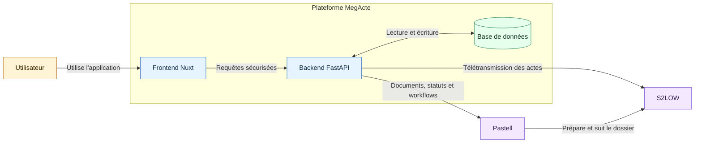

# Architecture de MegActe

## Vue d'ensemble

MegActe est une application web qui facilite la préparation et le suivi des
actes administratifs. Elle sert d'interface entre les utilisateurs et les
services métier externes utilisés par les collectivités.

L'application est organisée autour de cinq briques principales :

- **Frontend Nuxt** : l'interface visible par les utilisateurs.
- **Backend FastAPI** : le point d'entrée central qui applique les règles
  métier et orchestre les échanges.
- **Base de données** : le stockage local des informations nécessaires au
  fonctionnement de MegActe.
- **Pastell** : le service de gestion des documents et des workflows.
- **S2LOW** : le service de télétransmission des actes vers les services de
  l'État.

## Schéma d'architecture

## Rôle des composants

### Frontend Nuxt

Le frontend constitue la partie visible de MegActe : écrans, formulaires,
listes et suivi des actes. Il ne dialogue pas directement avec Pastell ou
S2LOW. Il échange avec le backend, ce qui permet de centraliser la sécurité
et les règles de fonctionnement.

### Backend FastAPI

Le backend est le coordinateur de la plateforme. Il :

- reçoit les demandes du frontend ;
- vérifie les droits d'accès ;
- applique les règles métier ;
- lit et enregistre les données locales ;
- communique avec Pastell et S2LOW ;
- renvoie au frontend un résultat adapté à l'utilisateur.

Cette position intermédiaire évite d'exposer directement les services
externes au navigateur.

### Base de données

La base de données conserve les informations propres à MegActe, par exemple
les utilisateurs connus, les paramètres et les données nécessaires au suivi
local. Elle complète Pastell : elle ne remplace pas le service de gestion
documentaire externe.

### Pastell

Pastell est le service de référence pour la gestion des documents et des
workflows d'actes. MegActe lui transmet ou lui demande des informations sur
les dossiers, leurs documents et leur avancement.

### S2LOW

S2LOW intervient pour la télétransmission des actes. Une fois le dossier prêt,
MegActe s'appuie sur les services concernés pour transmettre l'acte et suivre
le retour associé.

## Exemple de parcours

1. Un utilisateur prépare ou consulte un acte depuis le frontend Nuxt.
2. Le frontend envoie la demande au backend FastAPI.
3. Le backend vérifie l'accès et récupère les informations locales utiles.
4. Il échange avec Pastell pour gérer le dossier et son workflow.
5. Lorsque l'acte est prêt, il est transmis via S2LOW.
6. Les statuts utiles sont enregistrés ou synchronisés, puis présentés à
   l'utilisateur dans MegActe.

## À retenir

MegActe est une **surcouche applicative** : son interface simplifie l'usage,
son backend orchestre les opérations, et Pastell ainsi que S2LOW assurent les
services métier et la télétransmission. La base de données conserve le
contexte nécessaire au fonctionnement de la plateforme.
