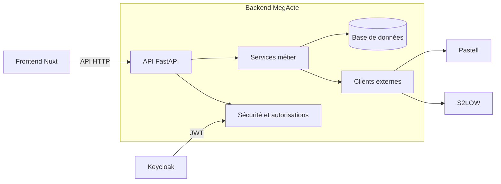

# Le backend de MegActe

## 1. Rôle général

Le backend est le serveur qui fait fonctionner MegActe. Il se situe entre
l'interface utilisateur et les services externes utilisés par la plateforme.

Son rôle principal est de recevoir les demandes du frontend Nuxt, de les
sécuriser, d'appliquer les règles métier, puis de communiquer avec la base de
données, Pastell et S2LOW.

Le backend évite ainsi que le navigateur communique directement avec les
services externes. Il constitue un point de contrôle unique pour les droits
d'accès, les données sensibles et le déroulement des opérations.

## 2. Parcours d'une requête

Une requête suit généralement les étapes suivantes :

1. L'utilisateur effectue une action dans le frontend Nuxt.
2. Le frontend appelle une route HTTP du backend.
3. Le backend vérifie le jeton d'authentification et les droits de
   l'utilisateur.
4. Il identifie l'utilisateur et récupère son contexte local.
5. Le service métier réalise l'opération demandée.
6. Si nécessaire, le backend consulte ou met à jour la base de données et
   appelle Pastell ou S2LOW.
7. La réponse est normalisée puis renvoyée au frontend.

Cette organisation permet au frontend de rester simple : il demande une
opération fonctionnelle sans avoir à connaître les détails des API Pastell ou
S2LOW.

## 3. Organisation du code

Le code du backend se trouve dans le dossier `back/`. L'application FastAPI
est principalement organisée dans `back/app/`.

### 3.1 Application et démarrage

Le fichier `back/app/main.py` construit l'application FastAPI. Il :

- enregistre les routes de l'application ;
- applique la protection d'authentification aux routes métier ;
- configure le middleware CORS ;
- installe les gestionnaires d'erreurs ;
- démarre et arrête les tâches de synchronisation ;
- expose une route de santé non protégée.

Le démarrage peut notamment déclencher une synchronisation des utilisateurs
Pastell. Si elle est activée dans la configuration, cette synchronisation est
ensuite exécutée périodiquement en arrière-plan.

### 3.2 Routes HTTP

Les routes sont regroupées dans `back/app/routers/`, par domaine fonctionnel :

- `users.py` : gestion des utilisateurs et opérations d'administration ;
- `documents.py` : accès aux documents et aux fichiers ;
- `flux.py` : gestion des flux et de leur progression ;
- `connecteurs.py` : gestion des connecteurs, notamment le télétransmetteur ;
- `entite.py` : accès aux informations des entités ;
- `health.py` : vérification de disponibilité du backend.

Les routeurs décrivent le contrat HTTP de l'application : URLs, paramètres,
codes de réponse et données attendues. Ils délèguent le travail métier aux
services afin de ne pas concentrer toute la logique dans les contrôleurs.

### 3.3 Services métier

Les services se trouvent dans `back/app/services/`. Ils contiennent les
opérations fonctionnelles de MegActe, par exemple :

- créer et gérer des actes ;
- gérer les documents associés ;
- piloter les étapes d'un flux ;
- gérer les connecteurs de télétransmission ;
- gérer les utilisateurs ;
- synchroniser les utilisateurs avec Pastell.

Cette couche traduit une demande technique, comme un appel HTTP, en une
opération compréhensible par le métier. Elle coordonne les modèles locaux et
les clients des systèmes externes.

### 3.4 Clients des services externes

Les clients sont regroupés dans `back/app/clients/`. Ils encapsulent les
appels vers les systèmes que MegActe ne contrôle pas directement :

- le client Pastell gère les échanges avec Pastell et ses modèles de réponse ;
- le client S2LOW gère les échanges nécessaires à la télétransmission.

Cette séparation protège le reste du code contre les détails propres à chaque
API externe. Si une API change, les adaptations doivent en priorité rester
dans son client ou dans le service qui l'utilise.

### 3.5 Modèles et schémas

Les modèles SQLAlchemy de `back/app/models/` représentent les données
stockées en base. Ils servent notamment à représenter les utilisateurs, les
flux et les informations de connecteurs.

Les schémas Pydantic de `back/app/schemas/` décrivent les données entrantes et
sortantes de l'API. Ils permettent de valider les requêtes et de fournir au
frontend des réponses structurées.

Les migrations de structure de la base sont gérées par Alembic dans le dossier
`back/migrations/`.

## 4. Sécurité et identification

### 4.1 Authentification avec Keycloak

Les routes métier attendent un jeton JWT fourni par Keycloak. Le backend :

1. récupère le jeton transmis par le frontend ;
2. vérifie sa signature à l'aide des clés publiques de Keycloak ;
3. vérifie son audience ;
4. refuse la requête si le jeton est invalide.

La route de santé est volontairement accessible sans authentification afin de
permettre à l'infrastructure de vérifier que le service répond.

### 4.2 Utilisateur applicatif

Le JWT contient notamment le login de l'utilisateur. Le backend utilise ce
login pour retrouver l'utilisateur dans la table locale `pastell_users`.

Un utilisateur doit être connu et actif dans cette base pour accéder aux
fonctionnalités métier. Le backend peut également utiliser les informations
de SIREN ou de SIRET présentes dans le jeton pour associer l'utilisateur à son
contexte de collectivité.

### 4.3 Rôles administrateur

Certaines opérations sont réservées aux utilisateurs ou comptes techniques
disposant du rôle d'administration configuré dans Keycloak. Le backend vérifie
ce rôle dans les rôles du JWT avant d'autoriser l'opération.

## 5. Gestion des identités Pastell et S2LOW

Le backend maintient un lien entre l'identité Keycloak et les comptes utilisés
par les services métier.

Lorsqu'un utilisateur est reconnu localement :

- son token Pastell peut être créé s'il n'existe pas ou n'est plus valide ;
- ce token est stocké chiffré en base ;
- le backend peut s'assurer que le compte S2LOW correspondant à son SIREN ou
  son SIRET existe.

Le frontend n'a pas besoin de gérer ces tokens ni les mécanismes de création
de comptes. Cette responsabilité reste côté serveur.

## 6. Base de données locale

La base locale ne remplace pas Pastell. Elle conserve les informations dont
MegActe a besoin pour fonctionner et retrouver rapidement son contexte.

Elle sert notamment à :

- connaître les utilisateurs autorisés ;
- conserver les données propres à MegActe ;
- enregistrer les flux et les connecteurs ;
- conserver les informations nécessaires aux intégrations ;
- stocker de manière protégée les tokens Pastell associés aux utilisateurs.

Les accès à la base passent par SQLAlchemy. Une session est ouverte pour la
requête puis refermée automatiquement afin de libérer les ressources.

## 7. Synchronisation des utilisateurs

Une tâche de synchronisation peut être activée dans la configuration du
backend. Elle permet de mettre à jour les utilisateurs depuis Pastell.

Selon la configuration, le processus peut :

- nettoyer les utilisateurs locaux au démarrage ;
- effectuer une première synchronisation au lancement ;
- répéter la synchronisation à intervalle régulier ;
- exécuter le travail bloquant dans un thread séparé pour ne pas bloquer la
  boucle asynchrone de FastAPI.

Cette synchronisation évite de maintenir manuellement une liste d'utilisateurs
qui serait différente de celle de Pastell.

## 8. Gestion des erreurs

Les erreurs métier et techniques sont converties en réponses HTTP cohérentes
par les gestionnaires enregistrés dans `back/app/exceptions/`.

L'objectif est double :

- fournir au frontend un résultat exploitable et prévisible ;
- éviter d'exposer au client des détails internes ou des informations
  sensibles.

Les appels aux services externes doivent donc être considérés comme des
opérations susceptibles d'échouer : indisponibilité, erreur d'authentification,
données invalides ou délai dépassé.

## 9. Configuration et exploitation

La configuration du backend est chargée depuis les fichiers de configuration
et les variables d'environnement. Elle contient notamment les paramètres de :

- la base de données ;
- Keycloak ;
- Pastell ;
- S2LOW ;
- la synchronisation ;
- la journalisation.

Les secrets et paramètres propres à un environnement ne doivent pas être
placés dans le code source. Le dossier de configuration local est prévu pour
les valeurs propres à chaque installation.

## 10. Résumé

Le backend FastAPI est le coordinateur de MegActe. Il ne se limite pas à
exposer des routes HTTP : il sécurise les accès, retrouve le contexte de
l'utilisateur, applique les règles métier, dialogue avec la base de données,
Pastell et S2LOW, puis restitue un résultat homogène au frontend.

Cette architecture permet à MegActe de proposer une expérience simplifiée
tout en conservant les intégrations et les contraintes de sécurité dans une
couche serveur maîtrisée.
