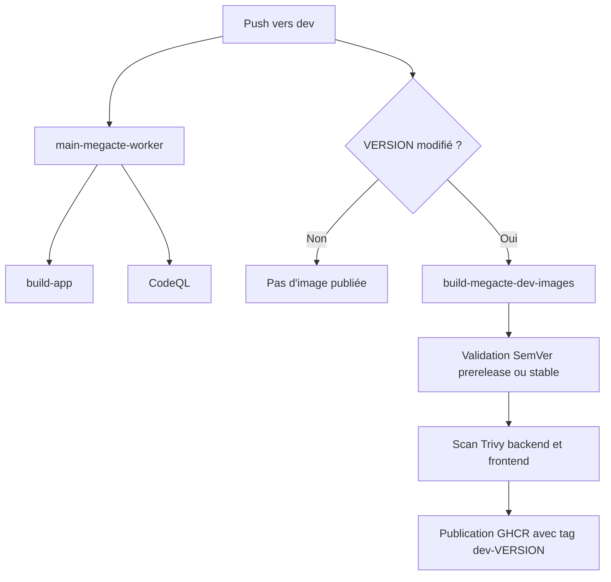
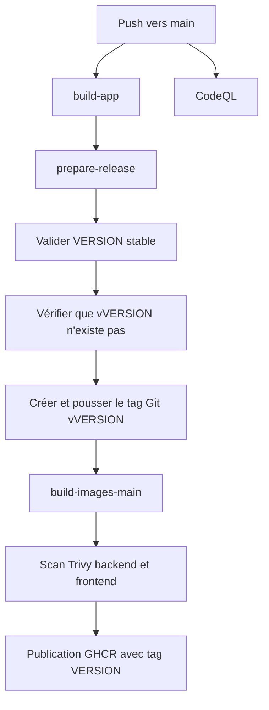
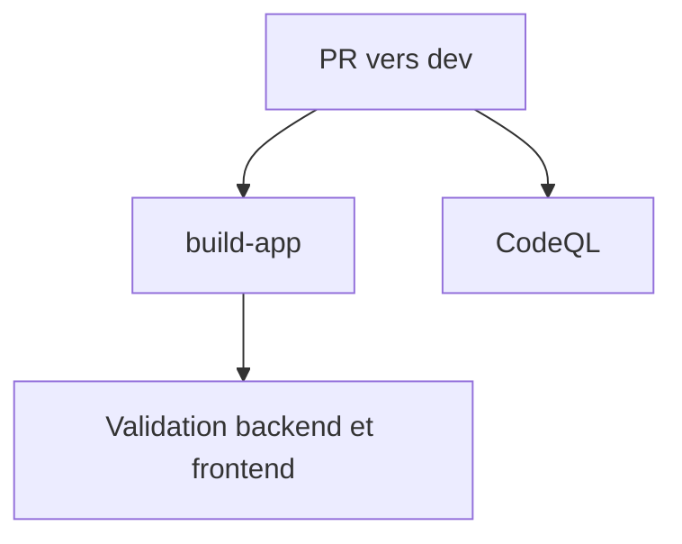
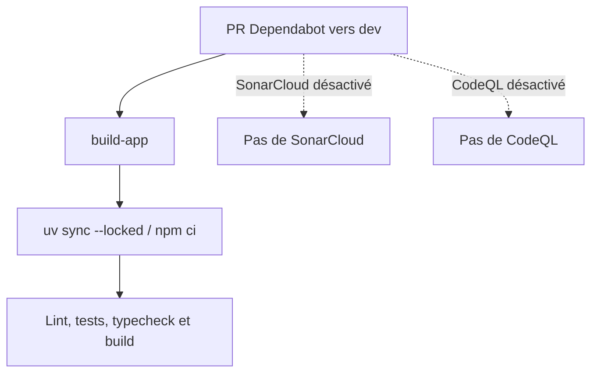
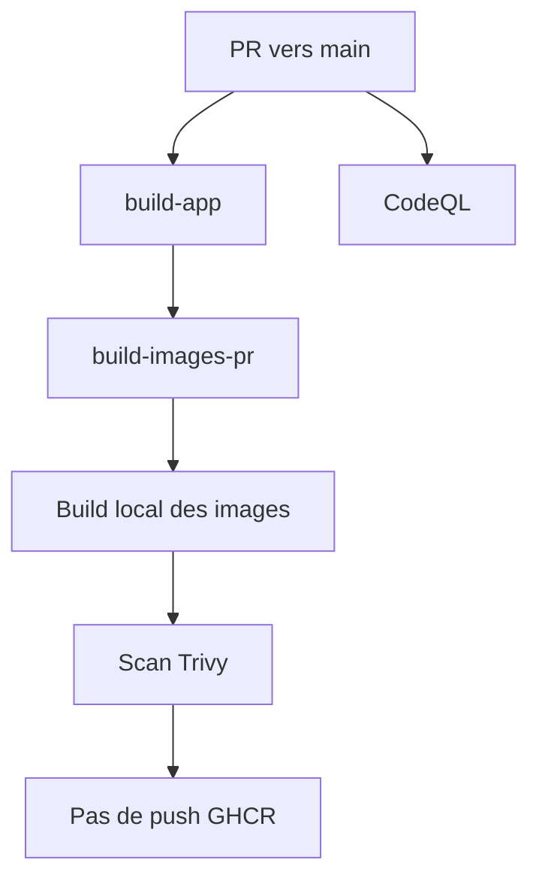

# Flux de développement et intégration continue

Ce document décrit le flux de développement de MegActe, la gestion des versions et les workflows GitHub Actions associés.

## Branches

| Branche | Rôle | Images publiées |
| --- | --- | --- |
| `dev` | Développement et intégration des changements | Images de développement, uniquement lorsqu'une modification de `VERSION` est poussée |
| `main` | Version stable et production | Images stables après chaque push validé |

Les PR Dependabot ciblent la branche `dev`, comme défini dans `.github/dependabot.yml`.

## Versions

Le fichier `VERSION` est la source de la version de l'application et se trouve à la racine du dépôt.

### Versions sur `dev`

Les versions de développement utilisent une version SemVer prerelease :

```text
0.3.6-rc.1
```

Une modification volontaire de `VERSION` sur `dev` déclenche la construction et la publication des images Docker de développement.

Les images sont publiées avec le préfixe `dev-` afin de ne jamais entrer en collision avec les images stables :

```text
ghcr.io/megalis-bretagne/megacte-back:dev-0.3.6-rc.1
```

### Versions sur `main`

Les versions de `main` doivent être des versions stables :

```text
0.3.6
```

Un push vers `main` valide la version, crée le tag Git `v0.3.6`, puis publie les images Docker sans préfixe :

```text
ghcr.io/megalis-bretagne/megacte-back:0.3.6
```

Le workflow de release refuse une version prerelease et refuse également de recréer un tag Git déjà existant.

## Dépendances et lockfiles

Les lockfiles font partie du code versionné et doivent rester synchronisés avec les manifests :

| Composant | Manifest | Lockfile | Installation CI |
| --- | --- | --- | --- |
| Backend | `back/pyproject.toml` | `back/uv.lock` | `uv sync --locked` |
| Frontend | `nuxt-web-app/package.json` | `nuxt-web-app/package-lock.json` | `npm ci` |

Dependabot utilise l'écosystème `uv` pour le backend et l'écosystème `npm` pour le frontend. Il cible `dev` et doit donc proposer les mises à jour des manifests et des lockfiles dans ses PR.

Le CI utilise volontairement des commandes strictes. Il doit échouer si un lockfile n'est pas à jour plutôt que résoudre silencieusement de nouvelles dépendances.

## Workflows GitHub Actions

### Vue d'ensemble

| Workflow | Déclencheur direct | Fonction |
| --- | --- | --- |
| `main-megacte-worker.yml` | Push vers `dev` ou `main`, PR vers `dev` ou `main`, exécution planifiée | Orchestration du build applicatif, de CodeQL, des images de PR et des releases |
| `build-megacte-app.yml` | Appelé par `main-megacte-worker.yml` | Build, lint, tests, couverture et SonarCloud |
| `build-megacte-dev-images.yml` | Push vers `dev` modifiant `VERSION` | Publication des images Docker de développement |
| `build-megacte-images.yml` | Appelé par les workflows principaux | Validation de `VERSION`, build et scan Trivy des images, publication optionnelle |
| `codeql.yml` | Appelé par `main-megacte-worker.yml` | Analyse CodeQL JavaScript/TypeScript et Python |
| `trivy.yml` | Appelé par `build-megacte-images.yml` | Build local et scan Trivy d'une image |

Les workflows `build-megacte-app.yml`, `build-megacte-images.yml`, `codeql.yml` et `trivy.yml` sont des workflows réutilisables. Ils ne sont pas déclenchés directement par un événement GitHub.

## Workflow de build applicatif

`build-megacte-app.yml` exécute deux jobs indépendants :

```text
build-app
├── backend
│   ├── uv sync --locked
│   ├── Ruff check
│   ├── Ruff format --check
│   ├── Tests Python avec couverture
│   └── SonarCloud, sauf PR Dependabot
└── frontend
    ├── npm ci
    ├── Lint
    ├── Typecheck
    ├── Tests unitaires avec couverture
    ├── Build Nuxt
    └── SonarCloud, sauf PR Dependabot
```

SonarCloud est désactivé pour les PR Dependabot car ces PR ne nécessitent pas l'analyse de qualité du code. Les tests, le lint, le typecheck et le build restent exécutés.

## Matrice des événements

Le tableau suivant décrit les jobs effectivement exécutés par événement.

| Événement | `build-app` | CodeQL | Images de PR | Images dev | Release/tag | Images stables |
| --- | --- | --- | --- | --- | --- | --- |
| Push vers `dev` sans modification de `VERSION` | Oui | Oui | Non | Non | Non | Non |
| Push vers `dev` avec modification de `VERSION` | Oui | Oui | Non | Oui, avec préfixe `dev-` | Non | Non |
| Push vers `main` | Oui | Oui | Non | Non | Oui | Oui, après release |
| PR vers `dev` | Oui | Oui sauf Dependabot | Non | Non | Non | Non |
| PR Dependabot vers `dev` | Oui, sans SonarCloud | Non | Non | Non | Non | Non |
| PR vers `main` | Oui | Oui | Oui, sans publication | Non | Non | Non |
| PR Dependabot vers `main` | Oui, sans SonarCloud | Non | Oui, sans publication | Non | Non | Non |
| Exécution planifiée | Non | Oui | Non | Non | Non | Non |

Les événements `opened`, `synchronize` et `reopened` sont pris en compte pour les PR. La fermeture ou le merge d'une PR ne déclenche pas directement ce workflow. Un merge vers `dev` ou `main` crée en revanche un nouveau commit sur la branche cible et déclenche donc un événement `push`.

## Push vers `dev`



Le workflow d'images de développement est indépendant du workflow principal et ne se déclenche que si le commit modifie le fichier `VERSION`.

Exemple :

```text
VERSION = 0.3.6-rc.1
        |
        +--> megacte-back:dev-0.3.6-rc.1
        +--> megacte-web:dev-0.3.6-rc.1
```

## Push vers `main`



Si `build-app` échoue, `prepare-release` ne démarre pas. Si la version n'est pas stable ou si le tag Git existe déjà, la release et la publication des images échouent.

## PR vers `dev`



Aucune image Docker n'est publiée pour une PR vers `dev`. Pour publier une image de développement, il faut modifier `VERSION` puis pousser cette modification sur `dev`.

Pour une PR Dependabot vers `dev` :



## PR vers `main`



Les images construites pour une PR vers `main` sont uniquement utilisées pour validation. Elles ne sont pas publiées dans GHCR.

## Merge vers `dev`

Un merge vers `dev` est traité comme un push vers `dev` :

```text
Merge PR vers dev
        |
        +--> Push dev
              |
              +--> build-app
              +--> CodeQL
              +--> build images dev si VERSION a changé
```

La publication d'une image dépend donc du contenu du commit résultant du merge. Si la PR modifiait `VERSION`, une image de développement est publiée.

## Merge vers `main`

Un merge vers `main` est traité comme un push vers `main` :

```text
Merge PR vers main
        |
        +--> Push main
              |
              +--> build-app
              +--> CodeQL
              +--> prepare-release
                    |
                    +--> tag Git vVERSION
                    +--> images stables VERSION
```

Les images stables sont donc toujours reconstruites depuis `main`. Elles utilisent un tag différent des images de développement et ne les écrasent pas.

## Images Docker et immutabilité

GHCR ne rend pas automatiquement les tags Docker immuables. Un nouveau push avec le même tag peut déplacer ce tag vers un autre digest.

La convention du projet réduit ce risque :

| Source | Exemple de tag |
| --- | --- |
| `dev` | `dev-0.3.6-rc.1` |
| `main` | `0.3.6` |

Une version publiée ne doit pas être réutilisée. Pour une reproductibilité complète, les déploiements devraient utiliser le digest de l'image :

```text
ghcr.io/megalis-bretagne/megacte-back@sha256:<digest>
```

## Résumé opérationnel

| Action | Résultat |
| --- | --- |
| Pousser du code sur `dev` | Validation applicative et CodeQL |
| Modifier `VERSION` puis pousser sur `dev` | Validation précédente + images `dev-VERSION` publiées |
| Ouvrir ou mettre à jour une PR vers `dev` | Validation applicative et CodeQL |
| Ouvrir ou mettre à jour une PR Dependabot vers `dev` | Validation applicative sans SonarCloud ni CodeQL |
| Merger vers `dev` | Même comportement qu'un push vers `dev` |
| Ouvrir ou mettre à jour une PR vers `main` | Validation applicative, CodeQL et scans Trivy sans publication |
| Merger vers `main` | Validation, tag Git `vVERSION`, scans et publication des images stables |
| Lancer l'exécution planifiée | CodeQL uniquement |
